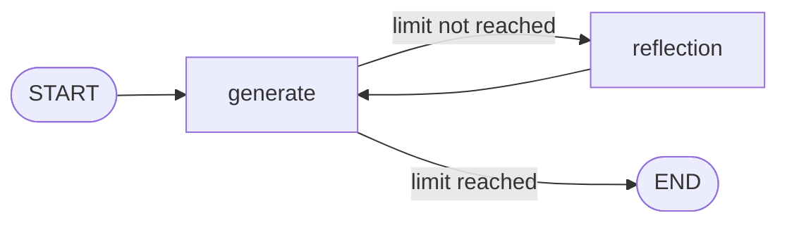

# Reflection Agent with LangGraph and Ollama

A small, local **reflection agent** built with [LangGraph](https://docs.langchain.com/oss/python/langgraph/overview)
and a local [Ollama](https://ollama.com/) model. One LLM role **writes** a draft, a second role
**reviews** it, and the writer **rewrites** the draft using that feedback. The loop stops after a
fixed number of messages.

This is a learning project. The goal is to understand the mechanics of a cyclic graph, not to
produce the best possible text.

---

## Table of contents

1. [What it does](#what-it-does)
2. [How it works](#how-it-works)
3. [Project structure](#project-structure)
4. [Setup](#setup)
5. [Run](#run)
6. [Code reference](#code-reference)
7. [Example run](#example-run)
8. [Lessons learned](#lessons-learned)
9. [Known limitations](#known-limitations)
10. [Troubleshooting](#troubleshooting)
11. [Roadmap](#roadmap)

---

## What it does

Given a request such as:

> Write a short LinkedIn post about LangGraph. Facts you may use: LangGraph is a framework for
> building stateful, graph-based agent workflows. It uses nodes and edges, supports loops and
> conditional routing, and can persist memory between runs. Do not state anything beyond these facts.

the graph runs this loop:

1. **Generate**: the writer produces a draft.
2. **Reflect**: the reviewer checks the draft against the original request and returns feedback.
3. **Generate again**: the writer rewrites the draft to address the feedback.
4. **Stop**: a router ends the run when the message limit is reached.

---

## How it works



### The two roles

Both roles use the **same model**. Only the system prompt differs.

| Node | Role | Sees | Output is stored as |
|---|---|---|---|
| `generate` | Writer | The whole conversation | `AIMessage` (a draft) |
| `reflection` | Reviewer | The original request and the latest draft | `HumanMessage` (feedback) |

Feedback is stored as a `HumanMessage` so the writer reads it as input to respond to, and the
conversation keeps alternating between human and AI messages.

### State

The graph uses LangGraph's built-in `MessagesState`: a single `messages` list. Each node returns
only the **new** message, and LangGraph **appends** it to the list.

### Message flow

`H1` is your request, `A1..` are drafts, `H2..` are critiques.

| Step | Node | Model receives | Adds | State size |
|---|---|---|---|---|
| 1 | `generate` | System (writer), `H1` | `A1` | 2 |
| 2 | `reflection` | System (reviewer), request and `A1` as text | `H2` | 3 |
| 3 | `generate` | System (writer), `H1`, `A1`, `H2` | `A2` | 4 |
| 4 | router | | stops at the limit | |

The number of rounds is controlled by `MAX_MESSAGES` in `main.py`. A limit of `4` gives one full
write, review, rewrite cycle (3 LLM calls). Each extra round adds two more messages and two more
LLM calls.

### Why `MessagesPlaceholder` matters

A prompt template can only use inputs it has a slot for. Without a
`MessagesPlaceholder("messages")`, the template silently ignores the conversation and the model
receives only the system prompt. The code runs without an error and produces plausible but
unrelated text. Both prompts in `chains.py` include the placeholder.

---

## Project structure

```
07-reflection-agent/
├── main.py            # Graph nodes, router, graph wiring, entry point
├── chains.py          # Prompts, LLM, writer chain, reviewer chain
├── .env               # Local settings (not committed)
├── .gitignore
├── pyproject.toml     # Dependencies (managed with uv)
└── README.md
```

Imports point one way only: `main.py` imports from `chains.py`.

---

## Setup

### Prerequisites

- Python 3.11 or newer
- [uv](https://docs.astral.sh/uv/)
- [Ollama](https://ollama.com/) installed and running

### Install

```bash
uv add langgraph langchain-core langchain-ollama python-dotenv
```

> Use `python-dotenv`, not `dotenv`. They are different packages, and
> `from dotenv import load_dotenv` comes from `python-dotenv`.

### Pull the model

```bash
ollama pull qwen3:1.7b
```

Any chat model that Ollama serves will work. Change `MODEL` in `chains.py` to switch.

### Environment

This project uses a local model, so no API key is required. Keep a `.env` file only if you add
hosted services later, and make sure it is listed in `.gitignore`.

---

## Run

```bash
uv run main.py
```

The script prints a text diagram of the graph, then every message in the final state.

---

## Code reference

### `chains.py`

```python
from langchain_core.prompts import ChatPromptTemplate, MessagesPlaceholder
from langchain_ollama import ChatOllama

MODEL = "qwen3:1.7b"

reflection_prompt = ChatPromptTemplate.from_messages([
    ("system",
     "You are a strict fact-checker. You receive the original request, which "
     "contains the allowed facts, and a draft. "
     "1. List every claim or adjective in the draft that is NOT supported by "
     "those facts. "
     "2. Check the length and format asked for in the request. "
     "Do not invent other requirements such as tone. Do not praise. "
     "If you find no problems, reply with exactly: APPROVED"),
    MessagesPlaceholder(variable_name="messages"),
])

generation_prompt = ChatPromptTemplate.from_messages([
    ("system",
     "You are a skilled writer. Output ONLY the final post text, with no preamble, "
     "no explanation and no sign-off. Keep it under 100 words. "
     "Use only words and claims supported by the facts you are given. "
     "Never invent statistics, user counts, links or product claims. "
     "When critique says to remove something, remove it; do not replace it."),
    MessagesPlaceholder(variable_name="messages"),
])

llm = ChatOllama(model=MODEL)

reflection_chain = reflection_prompt | llm
generation_chain = generation_prompt | llm
```

### `main.py`

```python
from dotenv import load_dotenv
load_dotenv()

from langchain_core.messages import HumanMessage
from langgraph.graph import StateGraph, MessagesState, START, END
from chains import reflection_chain, generation_chain

MAX_MESSAGES = 4   # 4 = one write, review, rewrite cycle


def generate_node(state: MessagesState):
    response = generation_chain.invoke({"messages": state["messages"]})
    return {"messages": [response]}


def reflection_node(state: MessagesState):
    request = state["messages"][0].content
    draft = state["messages"][-1].content
    prompt_text = f"Original request:\n{request}\n\nDraft:\n{draft}"
    response = reflection_chain.invoke(
        {"messages": [HumanMessage(content=prompt_text)]}
    )
    return {"messages": [HumanMessage(content=response.content)]}


def should_continue(state: MessagesState):
    if len(state["messages"]) >= MAX_MESSAGES:
        return END
    return "reflection"


builder = StateGraph(MessagesState)
builder.add_node("generate", generate_node)
builder.add_node("reflection", reflection_node)

builder.add_edge(START, "generate")
builder.add_conditional_edges("generate", should_continue, ["reflection", END])
builder.add_edge("reflection", "generate")

app = builder.compile()


def main():
    print(app.get_graph().draw_mermaid())   # text diagram, no internet needed
    request = (
        "Write a short LinkedIn post about LangGraph. "
        "Facts you may use: LangGraph is a framework for building stateful, "
        "graph-based agent workflows. It uses nodes and edges, supports loops "
        "and conditional routing, and can persist memory between runs. "
        "Do not state anything beyond these facts."
    )
    res = app.invoke({"messages": [HumanMessage(content=request)]})
    for m in res["messages"]:
        m.pretty_print()


if __name__ == "__main__":
    main()
```

### Design notes

| Choice | Reason |
|---|---|
| One conditional edge after `generate` | The only decision is "review again or stop" |
| Fixed edge `reflection → generate` | Feedback always returns to the writer |
| Reviewer receives the original request | Otherwise it cannot judge topic, length or allowed facts |
| Reviewer sees only the latest draft | Keeps its input small and avoids repeating earlier critiques |
| Fixed message limit as the stop rule | Simple and predictable. The reviewer can always find something to say, so "no critique" cannot be the stop signal |

---

## Example run

Request with grounding facts, `MAX_MESSAGES` at its default of `4`:

```
Human : Write a short LinkedIn post about LangGraph. Facts you may use: ...
AI    : LangGraph simplifies complex workflows with its node-based, graph-driven
        architecture. Powerful loops, conditional routing, and memory persistence
        enable robust, stateful agent systems. ...
Human : 1. The phrase "Powerful loops" is not explicitly mentioned ...
AI    : LangGraph offers a robust, stateful, graph-based framework for building
        complex workflows. It leverages nodes, edges, loops, and conditional
        routing, with memory persistence across runs. ...
```

The exact text varies between runs and between models.

---

## Lessons learned

These came from real runs while building this project.

| Lesson | What happened |
|---|---|
| **A missing `MessagesPlaceholder` fails silently** | The model never saw the request and wrote about "a thesis" and "a paper" |
| **Swapped prompts also fail silently** | The "writer" produced critique bullets because the prompt texts were in the wrong variables |
| **Open-ended critique invites invention** | The reviewer made up rules (formal tone) and the writer made up facts (10x faster, 500+ developers) |
| **More rounds made drafts longer and less accurate** | Without a length check, each round added content |
| **Ungrounded reflection shares blind spots** | Without facts in the request, writer and reviewer agreed on a wrong description of LangGraph |
| **Grounding beats prompt tweaks** | Putting true facts into the request fixed the topic error immediately |
| **Reviewers can echo their instructions** | A small model repeated "without inventing numbers" as if it had verified it |
| **A completed run is not a correct run** | Read the content of every message, not just the message count |

---

## Known limitations

- **Model size:** `qwen3:1.7b` is weak at following strict instructions and at spotting subtle
  violations such as unsupported adjectives ("robust", "scalable").
- **No external feedback:** the reviewer judges text with text. It cannot verify claims against
  the real world.
- **Message-count stop rule:** counting messages breaks if other message types are added later.
- **Reasoning text:** thinking models such as qwen3 may include reasoning in their output.
  Check a raw message if replies look longer than expected.
- **Cost:** each round adds two LLM calls, so reflection is more expensive than a single prompt.

---

## Troubleshooting

| Symptom | Likely cause | Fix |
|---|---|---|
| Output talks about "a thesis" or "a paper" | `MessagesPlaceholder` missing from a prompt | Add it after the system message in both prompts |
| Writer outputs critique bullets | Prompt texts are swapped | Check the system text under each variable name |
| `ValidationError` on `HumanMessage` | Typo such as `cotent` | Use `HumanMessage(content=...)` |
| `TypeError` on a chain result | Indexing an `AIMessage` like a dict | Use `response.content`, and wrap in `{"messages": [response]}` |
| Reviewer still runs after the router says `END` | Extra fixed edge from `generate` to `reflection` | Keep only the conditional edge |
| Import is slow or fails offline | `draw_mermaid_png()` called at import time | Use `draw_mermaid()` (text) inside `main()` |
| Connection refused | Ollama is not running | Start Ollama and check `ollama list` |

Quick prompt check, to see exactly what the model will receive:

```python
from langchain_core.messages import HumanMessage
from chains import generation_prompt

result = generation_prompt.invoke({"messages": [HumanMessage(content="Write a post")]})
for m in result.to_messages():
    print(type(m).__name__, ":", m.content[:60])
```

---

## Roadmap

- [ ] Add the `APPROVED` stop rule: end early when the reviewer finds nothing to fix, keeping the
      message limit as a safety cap
- [ ] Replace message counting with a dedicated `rounds` counter in a custom state
- [ ] Ground the reviewer with a search tool (for example Tavily) so claims can be checked
- [ ] Compare results across model sizes
- [ ] Add persistence with a checkpointer so a run can be resumed

---

## License

Add a license of your choice before publishing.